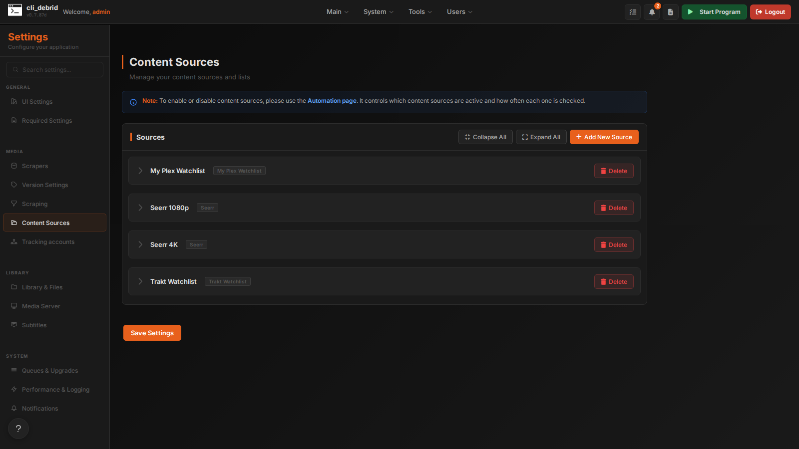

# Content Sources

Content sources tell Clyde **what to download**. Each source you enable is checked automatically on every processing cycle — any new items are added to the Wanted queue.

You can have multiple sources active at the same time.

To add one, go to **Settings → Content Sources** and click **Add New Source**. The picker groups every source type as **Watchlists**, **Lists**, **Collections** and **Requests**, with what each does and what it needs. Type to search.

Each source is checked on its own schedule: every 15 minutes by default, daily for Collected. Change a source's interval on the [Automation](../features/automation.md) page (Content Sources group, Advanced view).



---

## Common settings (all sources)

Every content source shares these settings regardless of type:

| Setting | Description |
|---|---|
| **Enabled** | Toggle the source on or off. Disabled sources are not deleted — they just stop being checked. |
| **Display Name** | The label used in the UI, logs, and Plex labels. |
| **Media Type** | Filter to **Movies** only, **Shows** only, or **All**. |
| **Versions** | Which quality profiles to use. Check all versions that should apply to this source. |
| **Allow Specials** | If enabled, Season 0 (Specials) episodes are also downloaded for TV shows. Default: off. |
| **Unblacklist on Source Run** | Re-queue items that were previously blacklisted every time this source runs. Default: off. |
| **Custom Symlink Subfolder** | (Symlinked mode only) Put downloads from this source in a specific subfolder. Leave blank to use the default. |
| **Cutoff Date** | Only download content released after this date. Accepts either a date (`2023-01-01`) or a number of days (`30` = only content from the last 30 days). Leave blank for no cutoff. |
| **Exclude Genres** | Skip items belonging to these genres. Useful to exclude e.g. Documentary or Animation from a broad source. |
| **List Length Limit** | Maximum number of items to process per run. `0` = no limit. |

**Watchlist sources** (Trakt Watchlist, My Plex Watchlist, Other Plex Watchlist and the Plex RSS watchlists) also have:

| Setting | Description |
|---|---|
| **Remove When Collected** | Remove items from the watchlist once they're collected. On Plex watchlists, movies go once every wanted version is collected, and shows only once the series has ended, so running shows keep getting new episodes. Default: off. |
| **Keep Series** | Never remove series, only movies. Default: off. |

These used to be global settings; existing values were copied to every source of the matching type.

---

## Plex Labels

Every source has an optional Plex Label setting. When enabled, items downloaded from this source are automatically labelled in Plex.

---

## Plex Collections

**Trakt Lists**, **MDBList**, and **Adaptive List** sources support an additional **Plex Collection** section that automatically creates and maintains a Plex collection mirroring the source list — with custom sort order and a designed poster.

See [Plex Collections](../features/plex-collections.md) for full setup and configuration details.

| Setting | Description |
|---|---|
| **Enabled** | Toggle Plex labelling for this source. |
| **Label Mode** | How the label is determined — see table below. |
| **Fixed Label** | The custom label text if Label Mode is set to **Fixed**. |

**Label Mode options:**

| Mode | What gets applied | Available on |
|---|---|---|
| `list_name` | The source's Display Name | All sources |
| `fixed` | The text you type in Fixed Label | All sources |
| `requester` | The Seerr requester's username | Seerr only |

---

## Available sources

| Source | What it does |
|---|---|
| **Watchlists** | |
| [My Plex Watchlist](#my-plex-watchlist) | Your own Plex watchlist |
| [Other Plex Watchlist](#other-plex-watchlist) | Another plex.tv account's or Plex Home profile's watchlist |
| [Plex Friends Watchlist](#plex-friends-watchlist) | Your Plex friends' watchlists |
| [My Plex RSS Watchlist / My Friends Plex RSS Watchlist](#plex-rss-watchlists) | A Plex watchlist through its RSS feed |
| [Trakt Watchlist](#trakt-watchlist) | Your Trakt watchlist |
| [Friends Trakt Watchlist](#friends-trakt-watchlist) | A friend's Trakt watchlist |
| [Simkl Watchlist](#simkl-watchlist) | Your Simkl Plan to Watch list, and other statuses if you choose |
| [Floppy Watchlist](#floppy-watchlist-and-floppy-lists) | Titles you track in Floppy with the chosen statuses |
| **Lists** | |
| [MDBList](#mdblist) | Any MDBList list, or a compatible JSON list URL |
| [Trakt Lists](#trakt-lists) | Your own or public Trakt lists, by URL |
| [Special Trakt Lists](#special-trakt-lists) | Trakt charts: trending, popular, anticipated and more |
| [Scrob Lists / Special Scrob Lists](#scrob) | Lists and charts on your Scrob server |
| [Floppy Lists](#floppy-watchlist-and-floppy-lists) | Custom lists on your Floppy server |
| [Adaptive List](#adaptive-lists) | TMDB filters whose results change over time |
| **Collections** | |
| [Collected](#collected) | Shows already in your library: new and missing episodes are added as they air |
| [Trakt Collection](#trakt-collection) | Your Trakt collection |
| [Scrob Collection](#scrob) | Your Scrob collection |
| **Requests** | |
| [Seerr](#seerr) | Approved requests from Seerr (Overseerr / Jellyseerr) |
| [Agregarr](#agregarr) | Agregarr sends its requests to Clyde as if it were Overseerr |

---|---|
| [Trakt Watchlist](#trakt-watchlist) | Your personal Trakt watchlist |
| [Trakt Lists](#trakt-lists) | Any public or private Trakt list by URL |
| [Trakt Collection](#trakt-collection) | Items marked as collected in Trakt |
| [Special Trakt Lists](#special-trakt-lists) | Built-in Trakt charts — trending, popular, anticipated, etc. |
| [Friends Trakt Watchlist](#friends-trakt-watchlist) | A friend's Trakt watchlist |
| [Seerr](#seerr) | Approved requests from Seerr |
| [MDBList](#mdblist) | Curated lists from mdblist.com |
| [My Plex Watchlist](#my-plex-watchlist) | Your personal Plex watchlist |
| [Other Plex Watchlist](#other-plex-watchlist) | Another Plex user's watchlist |
| [Plex RSS Watchlists](#plex-rss-watchlists) | Plex watchlist via RSS feed URL |
| [Plex Watch History](#plex-watch-history) | Items from your Plex watch history |
| [Agregarr](#agregarr) | Content from an Agregarr instance |
| [Collected](#collected) | Items already marked as collected in Clyde |
| [Adaptive List](#adaptive-lists) | Dynamic TMDB Discover-based list with custom filters |

---

## Trakt Watchlist

Your personal Trakt watchlist. Any item you add to your watchlist on Trakt will be downloaded automatically.

**Setup:**

1. Go to **Settings → Content Sources**
2. Find **Trakt Watchlist** and click to expand it
3. Toggle **Enabled** on
4. Set your preferred **Media Type** and **Versions**
5. Click **Save**

That's it — no URLs or API keys needed. Clyde uses the Trakt account you signed in with under [Settings → Tracking accounts](tracking-accounts.md#trakt).


---

## Trakt Collection

Items you have marked as "Collected" in your Trakt account. Useful if you want Clyde to ensure everything in your Trakt collection is actually downloaded.

**Setup:** Same as Trakt Watchlist — just enable and configure. No extra fields required.

---

## Trakt Lists

Monitors one or more Trakt lists by URL. Works with your own lists and any public list from any Trakt user.

**Additional field:**

| Field | Description |
|---|---|
| **Trakt List URLs** | One or more Trakt list URLs, separated by commas. |

**How to get a Trakt list URL:**

1. Go to [trakt.tv](https://trakt.tv) and log in
2. Navigate to any list — your own (under **Lists**) or someone else's public list
3. Copy the URL from your browser's address bar

**URL formats you can use:**

```
https://trakt.tv/users/yourusername/lists/my-list-name
https://trakt.tv/users/someotheruserr/lists/their-public-list
```

**To add multiple lists**, separate with commas:

```
https://trakt.tv/users/alice/lists/watchlist, https://trakt.tv/users/bob/lists/sci-fi
```


---

## Special Trakt Lists

Built-in Trakt charts — no URL needed. Choose from trending, popular, anticipated, and more.

**Additional field:**

| Field | Options |
|---|---|
| **List Types** | Multi-select — pick one or more from the list below |

**Available list types:**

| Type | Description |
|---|---|
| **Trending** | Most popular right now based on active watches |
| **Popular** | All-time most popular |
| **Favorited** | Most added to Trakt favourites |
| **Played** | Most watched overall |
| **Watched** | Most recently watched across all users |
| **Collected** | Most collected by Trakt users |
| **Anticipated** | Highest anticipated upcoming releases |
| **Box Office** | Current top 10 box office (Movies only) |

!!! warning "Box Office is movies only"
    If you select **Box Office**, set **Media Type** to **Movies**. It won't return results for TV shows.

**Setup:**

1. Enable **Special Trakt Lists**
2. Select which list types you want (hold Ctrl/Cmd to select multiple)
3. Set **Media Type** (especially important for Box Office)
4. Set **Versions** and save

---

## Friends Trakt Watchlist

Download items from a friend's Trakt watchlist. The friend needs to authorise their Trakt account via Clyde's built-in friend management page.

**Setting up a friend's Trakt account:**

1. Go to `http://YOUR_SERVER_IP:5000/trakt_friends/manage`
2. Your friend needs to create a Trakt API application at [trakt.tv/oauth/applications](https://trakt.tv/oauth/applications) and provide their **Trakt Client ID** and **Trakt Client Secret**
3. Enter their Client ID and Client Secret and click **Start Authorization**
4. Your friend completes the OAuth flow to grant access
5. Once authorised, their account appears in the **Authorized Friends** list
6. Their username can then be used in the **Friends Trakt Watchlist** content source

---

## Seerr

Automatically downloads approved requests from your Seerr instance.

**Additional fields:**

| Field | Description |
|---|---|
| **URL** | Full URL to your Seerr instance, e.g. `http://192.168.1.10:5055` |
| **API Key** | Your Seerr API key |
| **Ignore Tags** | Comma-separated Seerr tags to skip. Items with any of these tags won't be downloaded. |
| **Allow Partial Requests** | Only add the seasons that were requested in Seerr, instead of the whole show. Default: off. |

**How to find your Seerr API key:**

1. Log in to Seerr
2. Go to **Settings → General**
3. Copy the **API Key** from the top of the page

**Setup:**

1. Enable **Seerr**
2. Enter your **URL** (include `http://` or `https://` and the port number)
3. Paste your **API Key**
4. Optionally set **Ignore Tags** if you use Seerr tags to exclude certain requests
5. Set **Versions** and **Media Type**
6. Save

**Plex Label Mode for Seerr:**

The Seerr source supports `requester` as a Label Mode — this automatically labels items in Plex with the name of the person who requested them in Seerr. Great for multi-user setups.

!!! tip "Faster request pickup with webhooks"
    By default, Clyde checks Seerr on its normal processing cycle. For faster pickup (within seconds of approval), configure the Seerr webhook to notify Clyde immediately. See the [Integrations](../integrations/index.md) guide.


---

## MDBList

Monitors curated lists from [mdblist.com](https://mdblist.com). MDBList aggregates and maintains hundreds of themed lists — by genre, franchise, director, streaming platform, and more.

**Additional fields:**

| Field | Description |
|---|---|
| **API Key** | Your MDBList API key |
| **List URLs** | One or more MDBList list URLs, separated by commas |

**How to get your MDBList API key:**

1. Go to [mdblist.com](https://mdblist.com) and create a free account
2. Go to [mdblist.com/api](https://mdblist.com/api) while logged in
3. Copy your API key

**How to find a list URL:**

1. Browse to [mdblist.com/lists](https://mdblist.com/lists)
2. Find a list you want to use
3. Copy the URL from your browser address bar, e.g. `https://mdblist.com/lists/garycrawfordgc/top-rated-movies`

---

## My Plex Watchlist

Your personal Plex watchlist — anything you add to your Plex watchlist will be downloaded automatically.

**Setup:**

1. Enable **My Plex Watchlist**
2. Set **Media Type** and **Versions**
3. Save

No extra credentials needed — uses your Plex account from Required Settings.

---

## Other Plex Watchlist

Downloads items from another Plex user's watchlist (e.g. a family member or housemate).

**Additional fields:**

| Field | Description |
|---|---|
| **Username** | The other user's Plex username |
| **Token** | The other user's Plex authentication token |

**How to get a Plex token for another user:**

=== "Via cli_debrid (easiest)"

    Clyde has a built-in tool to collect Plex tokens from other users without needing them to dig through XML or share credentials.

    1. Go to `http://YOUR_SERVER_IP:5000/user_token/collect_tokens`
    2. Click **Generate User Login Link**
    3. Copy the generated **Code** or full **Link**
    4. Send it to the other user (via Discord, email, etc.)
    5. They visit the link (or go to `plex.tv/link` and enter the code) and sign in to their Plex account
    6. Once authorised, their Plex username and token will appear in the **Stored Tokens** list

    !!! warning "Security note"
        User tokens are stored in a local JSON file. Ensure your server's file system is properly secured.

=== "Manually"

    The other user can find their token by:

    1. Logging in to [Plex Web](https://app.plex.tv)
    2. Going to any media item → **Get Info** → **View XML**
    3. Copying the `X-Plex-Token=` value from the URL bar

---

## Plex RSS Watchlists

Monitors a Plex watchlist via its RSS feed URL. Works for your own watchlist or a friend's.

**Additional field:**

| Field | Description |
|---|---|
| **RSS URL** | The full RSS feed URL from Plex |

**How to get the Plex RSS feed URL:**

1. Log in to [app.plex.tv](https://app.plex.tv)
2. Click your profile picture → **Watchlist**
3. Look for the RSS feed icon or a Share/Export option
4. Copy the RSS URL

---

## Plex Watch History

Plex watch history isn't a content source. The **Import Plex watch history** task on the [Automation](../features/automation.md) page (Plex & Media Server group) downloads it daily, so items you've already watched aren't added to the queue again. To stop watch-history items being queued at all, turn on **Do Not Add Plex Watch History Items To Queue** under [Settings → Queues & Upgrades](queues-upgrades.md#content-processing).

---

## Plex Friends Watchlist

Adds the watchlists of your Plex friends.

| Field | Description |
|---|---|
| **Friends** | Comma-separated Plex usernames or display names. Leave empty for all friends. |

Uses your main Plex token. Each friend must allow their watchlist to be shared with friends in their Plex privacy settings.

---

## Simkl Watchlist

Adds titles from your [Simkl](https://simkl.com) lists. Needs the Simkl sign-in under [Settings → Tracking accounts](tracking-accounts.md#simkl).

| Field | Default | Description |
|---|---|---|
| **Simkl Statuses** | Plan to Watch | Which lists to add: Plan to Watch (the watchlist), Watching, On Hold, Completed, Dropped. Watching and On Hold only apply to shows and anime. |
| **Include Anime** | On | Also add anime from your Simkl anime list (Simkl keeps anime separate from shows) |

---

## Floppy Watchlist and Floppy Lists

Add titles from your [Floppy](https://github.com/dannyvfilms/Floppy) server. Both need the Floppy URL and API key under [Settings → Tracking accounts](tracking-accounts.md#floppy).

| Source | Field | Description |
|---|---|---|
| Floppy Watchlist | **Floppy Statuses** | Which statuses to add. Default: Planning, which is Floppy's watchlist. Also: In progress, Paused, Completed, Dropped. |
| Floppy Lists | **Floppy List IDs** | Comma-separated list IDs (the number in the list's URL, e.g. `/lists/3`), e.g. `3,7`. Floppy Lists can also create a Plex collection. |

---

## Scrob

Three source types use your [Scrob](https://github.com/ellite/scrob) server. All need the Scrob URL and API key under [Settings → Tracking accounts](tracking-accounts.md#scrob).

| Source | Field | Description |
|---|---|---|
| Scrob Lists | **Scrob List IDs** | Comma-separated numeric list IDs (from the list's URL in Scrob), e.g. `2,7` |
| Scrob Collection | — | Everything in your Scrob collection |
| Special Scrob Lists | **Special List Type** | Trending, Popular, Top Rated, Now Playing, Upcoming, On Air Today, On Air This Week, New Episodes, Hidden Gems, For You, Recently Added. Now Playing, Upcoming and Hidden Gems are movies only; the On Air and New Episodes lists are shows only. For You needs genre preferences in your Scrob profile. |
| Special Scrob Lists | **Special List Genres** | Optional genre lists (e.g. Animation), on their own or with the types above |

---

## Agregarr

Agregarr is a self-hosted content aggregation service. Rather than Clyde polling Agregarr, Agregarr **pushes** content to Clyde via webhook. When Agregarr has new content, it sends a POST request directly to Clyde.

**Connecting Clyde to Agregarr:**

In Agregarr, go to **Settings → Downloads → Seerr Settings** and add a new Seerr connection:

| Field | Value |
|---|---|
| **Hostname or IP Address** | Your Clyde server IP |
| **Port** | `5000` |
| **Use SSL** | Off (unless you have SSL configured) |
| **API Key** | Your Clyde API key if user management is enabled — otherwise any non-empty string will work (field cannot be left blank) |
| **URL Base** | `/webhook` |
| **External URL** | Leave blank unless Clyde is behind a reverse proxy |

Once saved, Agregarr will push new content directly to Clyde as it becomes available.

---

## Collected

Monitors items already marked as collected in Clyde. Useful to ensure previously collected content is re-downloaded if it goes missing or needs upgrading.

**Setup:** Enable and configure **Media Type** and **Versions**. No extra fields required.

---

## Adaptive Lists

Adaptive Lists use TMDB Discover to build a dynamic content list based on filters you define. Instead of pointing at a fixed list, you describe what kind of content you want — and Clyde finds it automatically.

**Example uses:**
- "Download all highly-rated sci-fi movies from the last 2 years"
- "Download currently trending TV shows with 1000+ votes"
- "Download all movies releasing in the next 7 days on Netflix"

### Adding an Adaptive List

1. Go to **Settings → Content Sources**
2. Click **Add Adaptive List**
3. A new source section appears — give it a **Display Name**
4. Click **Edit Filters** to open the filter builder
5. Configure your filters (see below)
6. Set **Versions** and any other options
7. Save

You can add multiple independent Adaptive Lists — each one is its own source with its own filters.


### Adaptive List filters

| Filter | Description | Example |
|---|---|---|
| **Media Type** | `movie` or `tv` | `movie` |
| **Released Within** | Content released in the last N days | `30` |
| **Upcoming Days** | Content releasing in the next N days | `7` |
| **Year Min / Max** | Release year range | `2020` / `2024` |
| **Rating Min / Max** | TMDB score range (0–10) | `7.0` / `10` |
| **Min Votes** | Minimum TMDB vote count — filters out obscure items | `500` |
| **Genres** | Include only these genres (TMDB genre IDs or names) | `28,12` (Action, Adventure) |
| **Exclude Genres** | Skip items with these genres | `99` (Documentary) |
| **Keywords** | Include items matching these TMDB keywords | |
| **Exclude Keywords** | Skip items matching these keywords | |
| **Language** | Original language (ISO 639-1 code) | `en` |
| **Streaming Providers** | Available on these platforms | Netflix, Disney+ |
| **Networks** | TV network (Shows only) | HBO, BBC |
| **Runtime Min / Max** | Film length range in minutes | `60` / `180` |
| **Title Filter** | Text or regex the title must match | |
| **Sort By** | Sort order for results | Popularity, Rating |
| **With Cast** | Filter by actor (TMDB person ID) | |
| **With Crew** | Filter by director/writer (TMDB person ID) | |

!!! tip "Start broad, then narrow"
    Start with just one or two filters (e.g. Rating Min + Genre) and see how many results it returns. Add more filters to narrow it down. A list with no votes filter and a broad genre can return thousands of items.

!!! tip "Use Min Votes to avoid junk"
    Setting **Min Votes** to at least `100`–`500` filters out obscure or low-quality items that have very few ratings.


---


## Troubleshooting

**Source is enabled but nothing is being downloaded**

- Check **Connections** (in the main navigation) to verify the source is reachable
- Check the logs for errors mentioning the source name
- Verify your API key or URL is correct
- Check if your **Cutoff Date** or **List Length Limit** is filtering everything out

**Items from this source keep getting blacklisted**

- Check your **Versions** configuration — the filters may be too strict for the content available
- Try enabling **Unblacklist on Source Run** to retry blacklisted items each cycle
