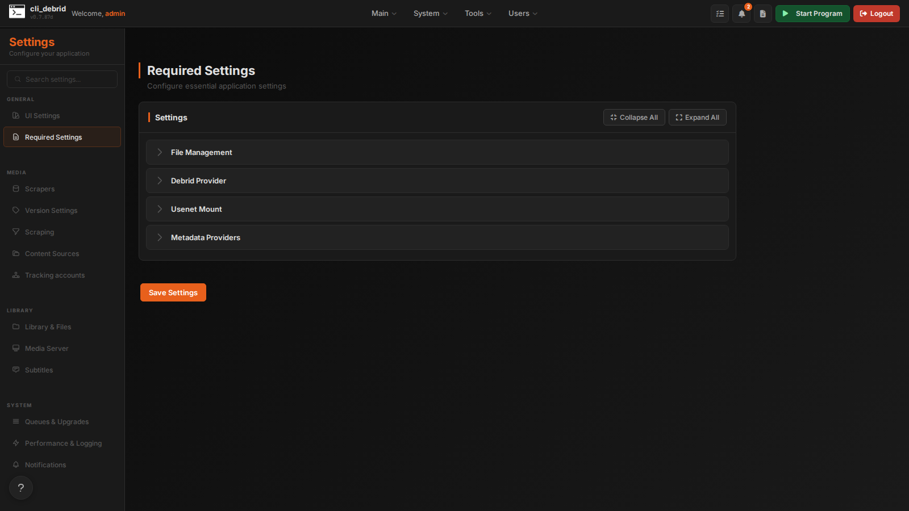

# Configuration

After completing the onboarding wizard, all settings are available in the **Settings** page. Settings are organised into pages, each named after what it holds.

---

## Settings pages

The Settings sidebar groups its pages into four sections:

| Section | Page | What it covers |
|---|---|---|
| **General** | [UI Settings](ui-settings.md) | Logo, date and time format, statistics page, user system, auto-run |
| | [Required Settings](required.md) | File management and your media server, debrid providers, Usenet mount, TMDB/TVDB keys |
| **Media** | [Scrapers](scrapers.md) | Torrentio, Jackett, Zilean, Nyaa, MediaFusion, Prowlarr, Newznab and more |
| | [Version Settings](versions.md) | Quality profiles: resolution, size, scoring, filter terms |
| | [Scraping](scraping.md) | Settings for all versions: uncached handling, minimum score, upgrading, filtering and the blacklist |
| | [Content Sources](content-sources.md) | Watchlists, lists, collections and requests to download |
| | [Tracking accounts](tracking-accounts.md) | MDBList, Trakt, Scrob, Floppy and Simkl accounts |
| **Library** | [Library & Files](library-files.md) | Deleting, symlink naming, post-processing scripts, file names |
| | [Media Server](media-server.md) | Plex collection posters, movie box sets, overlays, Plex Report Issue |
| | [Subtitles](subtitles.md) | Subtitle downloads and Bazarr |
| **System** | [Queues & Upgrades](queues-upgrades.md) | Queue order, wait times, upgrade handling |
| | [Performance & Logging](performance-logging.md) | Logging, metadata freshness, load limits, Phalanx DB |
| | [Notifications](notifications.md) | Discord, Telegram, Email, NTFY |

[Manage Users](manage-users.md) (accounts, roles, API tokens, SSO/OIDC) is under **Users** in the top menu, when the user system is on.

!!! note "Where did Additional and Advanced Settings go?"
    They were split into the pages above, named after what they hold. Scheduled tasks moved from the Task Manager to the [Automation](../features/automation.md) page, and the Debug page became [Tools](../features/tools.md) and [Maintenance](../features/maintenance.md). The search box finds a setting wherever it now lives.

---

## Finding settings quickly

The Settings page has a live search bar at the top. Start typing any setting name and it filters the pages and jumps to the field.

---

## How settings work

- Changes are applied immediately when you click **Save**
- Sensitive fields (API keys, tokens) are masked after saving
- Some settings require a program restart to take effect — these are labelled accordingly
- Settings are stored in `config.json` inside your mounted config volume

!!! tip "Onboarding vs Settings"
    The onboarding wizard only covers the minimum required settings. Everything else — notifications, scraping, overlays, subtitles — is configured through the Settings page after setup.

---

## Next steps

Start with [Required Settings](required.md) to verify your core connections, then work through [Content Sources](content-sources.md) and [Scrapers](scrapers.md) to start getting content.
