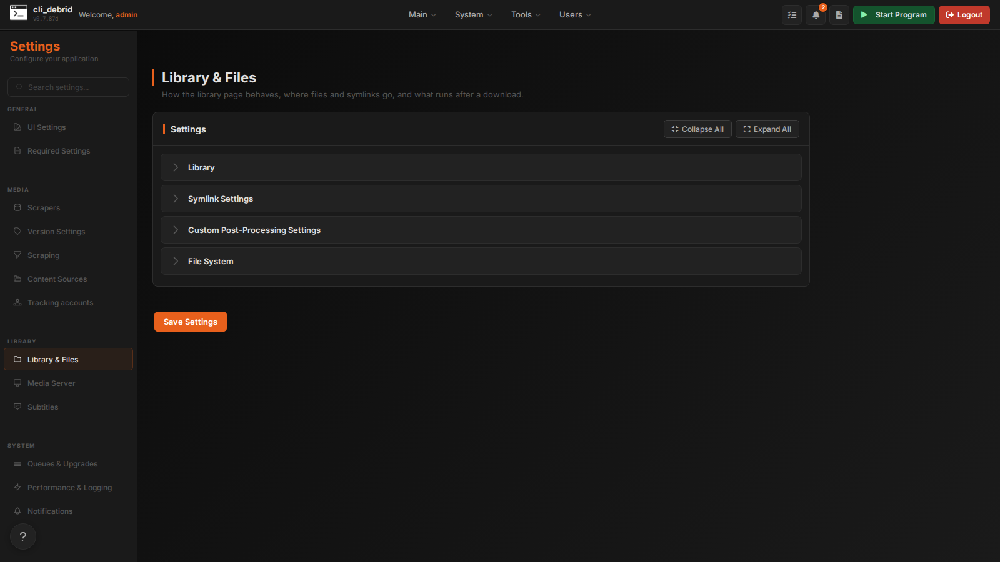

# Library & Files

**Settings → Library & Files** controls deleting from the library, symlink naming, post-processing scripts and file names.

---

## Library

| Setting | Default | Description |
|---|---|---|
| **Auto Ghostlist Deleted** | Off | When you delete a show or movie, mark it ghosted so content sources don't add it back. When off, deleted content can be re-added by dynamic sources. |
| **Remove From Content Sources** | On | When you delete something, also remove it from its content sources (Trakt lists, Seerr requests, Plex Watchlist…). Stops it coming back, but makes deleting slower. Turn it on when ghostlisting is off; with ghostlisting on, you can turn it off for faster deletes. |
| **Hide Season 0** | On | Hide the Specials tab and its episodes on show pages |
| **Enable Plex Removal Caching** | On | Queue Plex removals and run them after a delay instead of right away |
| **Plex Removal Cache Delay Minutes** | `360` | How long a queued Plex removal waits (6 hours by default) |
| **Cinesync Path** | — | Absolute path to your CineSync MediaHub `main.py` |
| **Enable Unmatched Items Check** | On | During collection scans, find and fix items Plex matched wrongly or not at all |

### Clear Artwork Cache

Removes all cached posters and backdrops. They're downloaded again from TMDB the next time the library loads.

### NAS / Network Drive Paths

Path prefixes that identify files on a NAS or network drive (e.g. `/MySamsungNAS_Movies/`). The Library, the Debrid Manager audit and the duplicate cleanups on the [Maintenance](../features/maintenance.md) page use them to filter NAS items. If none are set, the audit falls back to smart detection.

Add one entry per prefix. The prefix must match the start of the `location_on_disk` path stored in the database:

| Path in database | Prefix to add |
|---|---|
| `/192.168.1.124_Movies/Passengers.mkv` | `/192.168.1.124_Movies/` |
| `/mnt/nas/movies/Passengers.mkv` | `/mnt/nas/` or `/mnt/nas/movies/` |
| `/NAS/Media/Passengers.mkv` | `/NAS/` |

Check the **Library** or **Database** pages to see the exact paths stored.

---

## Symlink Settings

How symlink names and folders are built. Only used in Symlinked/Local mode.

| Setting | Default | Description |
|---|---|---|
| **Symlink Movie Template** | `{title} ({year})/{title} ({year}) - {imdb_id} - {version} - ({original_filename})` | Movie symlink names. Variables: `{title}`, `{year}`, `{imdb_id}`, `{tmdb_id}`, `{quality}`, `{version}`, `{original_filename}` |
| **Symlink Episode Template** | `{title} ({year})/Season {season_number:02d}/{title} ({year}) - S{season_number:02d}E{episode_number:02d} - {episode_title} - {imdb_id} - {version} - ({original_filename})` | Episode symlink names. Variables: `{title}`, `{year}`, `{imdb_id}`, `{tmdb_id}`, `{season_number}`, `{episode_number}`, `{episode_title}`, `{version}`, `{original_filename}`. For multi-episode files, `{episode_number}` becomes e.g. `E17-E18`. |
| **Organize By Resolution** | Off | Add a resolution folder (e.g. `1080p`, `2160p`) |
| **Organize By Version** | Off | Add a version folder (e.g. `Remux`, `WEB-DL`) |
| **Symlink Folder Order** | `type,version,resolution` | Drag to reorder the folder levels. The two settings above still decide whether the version and resolution levels are used. |
| **Enable Separate Anime Folders** | Off | Put anime in its own folders |
| **Enable Separate Documentary Folders** | Off | Put documentaries in their own folders |
| **Movies Folder Name** | `Movies` | Name of the Movies folder |
| **TV Shows Folder Name** | `TV Shows` | Name of the TV Shows folder |
| **Anime Movies Folder Name** | `Anime Movies` | Name of the Anime Movies folder |
| **Anime TV Shows Folder Name** | `Anime TV Shows` | Name of the Anime TV Shows folder |
| **Documentary Movies Folder Name** | `Documentary Movies` | Name of the Documentary Movies folder |
| **Documentary TV Shows Folder Name** | `Documentary TV Shows` | Name of the Documentary TV Shows folder |
| **Use Symlinks on Windows** | Off | Use symlinks on Windows. Needs administrator rights or Developer Mode. |

After changing these, run **Resync Symlinks with New Settings** on the [Tools](../features/tools.md#symlinks) page to rebuild existing symlinks.

---

## Custom Post-Processing Settings

Run your own script after an item is collected.

| Setting | Default | Description |
|---|---|---|
| **Enable Custom Script** | Off | Run the script during post-processing |
| **Custom Script Path** | — | Absolute path to the script |
| **Custom Script Arguments** | `{title} {imdb_id}` | Arguments passed to the script. Variables: `{title}`, `{year}`, `{type}`, `{imdb_id}`, `{location_on_disk}`, `{original_path_for_symlink}`, `{state}`, `{version}` |

---

## File System

| Setting | Default | Description |
|---|---|---|
| **Sanitizer Replacement Character** | `_` | Replaces characters that aren't allowed in file names. Must be valid on both Windows and Linux. |
