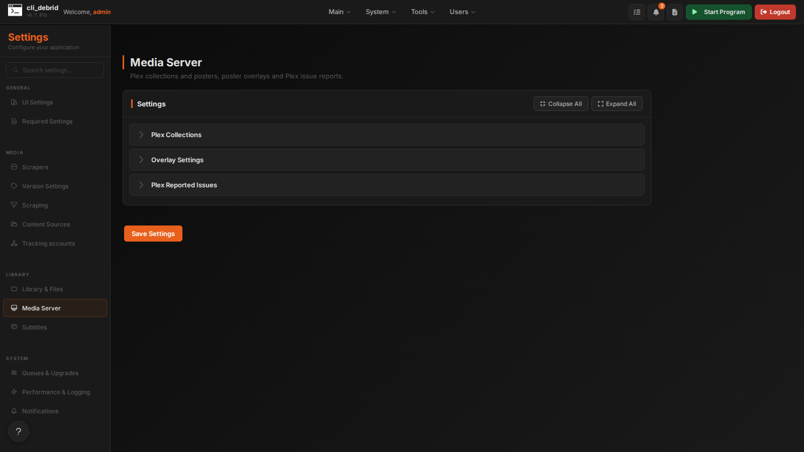

# Media Server

**Settings → Media Server** holds the extras cli_debrid can manage in Plex: collection posters and movie box sets, poster overlays, and replacing items people report through Plex.

Your Plex or Jellyfin/Emby connection itself is under [Required Settings → File Management](required.md).

---

## Plex Collections

### Smart collection posters

Applies one custom poster design to Plex's built-in smart collections (genre, network, language and so on). See [Plex Smart Collection Posters](../features/plex-smart-collections.md).

1. Click **Load Collections from Plex**
2. Tick the collections that should get the design
3. Pick the design and adjust it

The task runs every 24 hours. **Run Now** runs it straight away, and **Manage Posters** re-applies the poster for a single collection.

| Setting | Default | Description |
|---|---|---|
| **Poster Design** | Plex default | Layout for every ticked collection. Leave it on "None" for Plex's own poster. |
| **Poster Accent Color** | — | Accent color used in the design. Unset uses the layout's default. |
| **Card Overlay Opacity** | 60% | Darkness of the fade at the bottom of each card on the poster |
| **Accent Glow Opacity** | 80% | Strength of the accent glow around the poster edges |
| **Accent Glow Radius** | 55 | How far the glow spreads (10–200) |
| **Eyebrow Text** | — | Small text above the collection title. Blank hides it. |
| **Poster Icon** | — | Icon on the poster. Blank uses the source's default icon. |

### Movie box sets

Finds which TMDB franchise each of your movies belongs to, creates matching Plex collections with franchise posters, and can add the movies you're missing. See [Plex Movie Box Sets](../features/plex-movie-box-sets.md).

| Setting | Default | Description |
|---|---|---|
| **Enable Plex Movie Box Sets** | Off | Manage box set collections automatically |
| **Grab missing movies from box sets** | Off | Add the franchise movies you don't have to the Wanted queue |
| **Version to use when grabbing missing movies** | `Default` | Version used for those movies |
| **Collection name pattern** | `{title} Collection` | `{title}` is the franchise name. E.g. `{title} Box Set`, `{title} Saga` |
| **Minimum owned movies to create/keep a box set** | `2` | Box sets below this aren't created, and existing ones are removed |
| **Collection sort order** | Release date | How movies are ordered inside the collection |

---

## Overlay Settings

Poster overlays add media-info badges to your Plex posters. The badges themselves are designed on the [Overlays](../features/overlays.md) page.

| Setting | Default | Description |
|---|---|---|
| **Overlays Enabled** | Off | Turn on the overlay system and its sync tasks. Needs your Plex URL and token. |
| **Textless Posters** | Off | Start from a textless TMDB poster and add the title with the **Title Logo** badge. Falls back to the normal poster when TMDB has no textless one. |
| **Plex Data Path** | — | Plex Media Server's data folder (e.g. `/config/Library/Application Support/Plex Media Server`). Needed for the cleanup task to delete old uploaded posters. |
| **Overlay Content Check Interval Days** | `7` | How often to re-check ratings and show status for changes that need a new overlay. `0` checks on every sync. |
| **Sync Items Per Run** | `200` | Most shows and movies processed per sync. Higher clears a backlog faster, but each run takes longer. |

---

## Plex Reported Issues

Replaces movies and episodes that people report with Plex's **Report Issue** (the **…** menu on an item).

| Setting | Default | Description |
|---|---|---|
| **Enabled** | Off | Send reported items back to Wanted to get a different release. The current file keeps playing until the new one is in. Reports already in Plex when you turn this on are left alone. |
| **Reply To Reporter** | On | Reply in the Plex report thread when the report is picked up, and again once the item is replaced |

The **Replace items reported in Plex** task on the [Automation](../features/automation.md) page follows this setting.
