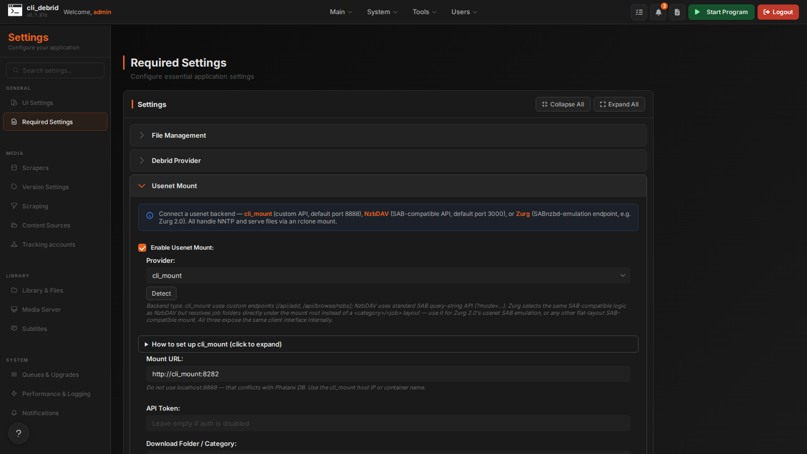

# Required Settings

These settings must be configured for Clyde to function. They are collected during onboarding and can be changed any time under **Settings → Required Settings**.



---

## Debrid Provider

**Debrid Providers** is one ranked list. Add a row for each debrid service (Real-Debrid, AllDebrid, Premiumize, TorBox, Debrid-Link or HighWay) with its API key, drag rows to set the order, and use each row's **Test** button to check the key. The first row is your main provider. Leave the list empty for a Usenet-only setup.

!!! tip "Getting your API key"
    === "Real-Debrid"
        Go to [real-debrid.com/apitoken](https://real-debrid.com/apitoken) while logged in.

    === "AllDebrid"
        Go to [alldebrid.com/apikeys](https://alldebrid.com/apikeys) while logged in.

    === "Premiumize"
        Go to [premiumize.me/account](https://www.premiumize.me/account) and look for **API Key**.

    === "Torbox"
        Go to [torbox.app/settings](https://torbox.app/settings) while logged in.

    === "Debrid-Link"
        Go to [debrid-link.com/webapp/apikey](https://debrid-link.com/webapp/apikey) while logged in.

### More than one provider

The list is an ordered chain. For each release Clyde checks the providers in order and adds it to the first one that has it cached. If a provider fails (rate limit, DMCA block, outage), Clyde tries the next one. Each provider needs its own API key. Use the arrows to change the order. Deleting from your library removes each torrent from the provider that added it. With two or more providers, the [Debrid Manager](../features/debrid-manager.md) has a provider picker.

!!! warning "AllDebrid"
    AllDebrid can't say whether a release is cached without adding it to your account, and it has suspended accounts that add many releases without downloading them. Clyde limits AllDebrid cache checks to 150 an hour and 10 per item, removes the ones it doesn't use, and only asks AllDebrid when no provider higher in the list has the release cached. Put AllDebrid lower in the list if you have another provider.

### Streaming only

!!! note "Built-in mount only"
    The **Streaming only** box on a fallback row only shows, and only applies, when the [built-in mount](../integrations/builtin-mount.md) serves your debrid. With cli_mount or Zurg the setting is ignored.

Tick **Streaming only** on a fallback to stop sending new releases to that account. Files it already holds keep playing through the built-in mount. They also stay visible in the Debrid Manager and the repair tools. The first provider in the list can't be streaming only.

### More debrid options

| Setting | Description |
|---|---|
| **Ffprobe All Debrid Additions** | Before collecting a debrid file, open it with `ffprobe` to confirm it plays, on top of the normal checks. Catches broken files before they reach your library (in Direct Mount, before Plex is told about them), but makes every addition slower. |
| **Enable Debrid Naming** | *cli_mount only.* Rename debrid entries in cli_mount's DFS mount to `{title} ({year}) - {imdb-id} - {version} - (original)` for movies and `{title} ({year}) - SxxExx - {episode title} - {imdb-id} - {version} - (original)` for episodes. Only the entry in cli_mount is renamed. Needs cli_mount configured as the Usenet provider (URL set). |
| ↳ **Include Version In Debrid Naming** | Add the version to the name. On by default. |
| ↳ **Include Content Source In Debrid Naming** | Add the content source's display name. Off by default. |

---

## Plex / Jellyfin

=== "Plex"

    | Setting | Description |
    |---|---|
    | **Plex URL** | Full URL to your Plex server, e.g. `http://192.168.1.10:32400` |
    | **Plex Token** | Your Plex authentication token |
    | **Shows Libraries** | Comma-separated list of your TV library names or IDs, e.g. `TV Shows,Anime` or `2,4` |
    | **Movie Libraries** | Comma-separated list of your movie library names or IDs, e.g. `Movies,4K Movies` or `1,3` |

    !!! tip "Using library IDs"
        You can use either the library name or its numeric ID. To find the ID, open your Plex library in the browser — the `source=` value at the end of the URL is the library ID. For example, `source=1` means the library ID is `1`.

    | Setting | Description |
    |---|---|
    | **Update Plex On File Discovery** | Tell Plex to scan as soon as a file is found on the mount. Clyde must be able to read the mount at the **Mounted File Location**. |
    | **Disable Plex Library Checks** | A "local only" mode for third-party symlinking: Clyde confirms files using the **Mounted File Location** instead of asking Plex. With no location set, items are marked Collected as soon as they're added. |

    ### Finding your Plex token

    1. Open [Plex Web](https://app.plex.tv) and browse to any media item
    2. Click the **...** menu → **Get Info** → **View XML**
    3. In the URL bar, copy the value after `X-Plex-Token=`

    Full guide: [:octicons-arrow-right-24: Plex integration](../integrations/plex.md){ .md-button }


=== "Jellyfin / Emby"

    !!! note "Either mode"
        Jellyfin and Emby work in both modes (Direct Mount since 0.8.7). In Direct Mount, pick **Jellyfin / Emby** as the **Media Server** under [File Management](#file-management); in Symlinked/Local, pick it as the **Media Server Type**.

    | Setting | Description |
    |---|---|
    | **Jellyfin/Emby URL** | Full URL to your Jellyfin/Emby server, e.g. `http://192.168.1.10:8096` |
    | **Jellyfin/Emby Token** | Your Jellyfin/Emby API token |
    | **Shows Libraries** | Comma-separated list of your TV library names |
    | **Movie Libraries** | Comma-separated list of your movie library names |

    ### Getting your Jellyfin API key

    1. In Jellyfin, go to **Dashboard → API Keys**
    2. Click **+** to create a new key
    3. Name it `cli_debrid` and copy the generated key

    Full guide: [:octicons-arrow-right-24: Jellyfin integration](../integrations/jellyfin.md){ .md-button }

---

## File Management

This is one of the most important settings.

=== "Direct Mount"

    Your media server reads directly from your debrid mount, and Clyde uses its API to track which files are in your library. Called **Plex mode** before 0.8.7.

    - **Media Server:** Plex, Silo or Jellyfin / Emby (Jellyfin and Emby since 0.8.7)
    - No symlinks needed
    - The media server must be able to read the mount path
    - Point the server's libraries at the mount's folders, e.g. a Movies library on `Movies/` and a TV library on `TV Shows/`

    **Mounted File Location:** Set to your mount path, e.g.:

    - cli_mount: `/path/to/debrid/__all__`
    - Zurg: `/mnt/zurg/__all__`
    - Decypharr: `/mnt/decypharr/__all__`

=== "Symlink mode"

    Clyde creates symlinks from the mount into an organised folder structure. Your media server scans the symlink folder.

    - Works with Plex, Jellyfin, Emby and Silo
    - Required on Windows (use Jellyfin — Plex doesn't support symlinks on Windows)

    | Field | Value |
    |---|---|
    | **Original files path** | Your mount path (e.g. `/path/to/debrid/__all__` for cli_mount, `/mnt/zurg/__all__` for Zurg, `/mnt/decypharr/__all__` for Decypharr) |
    | **Symlinked files path** | Where organised symlinks go, e.g. `/mnt/symlinks` |

    !!! warning "Volume mounts must match exactly"
        In symlink mode, Clyde creates symlinks that point to files inside the debrid mount. For these symlinks to resolve correctly, **both Clyde and your media server containers must mount the debrid storage and symlink folder at identical paths**.

        For example, if Clyde has:
        ```
        /mnt/remotes/zurg  →  /media/mount   (debrid mount)
        /mnt/symlinks      →  /mnt/symlinked  (symlink folder)
        ```
        Then Plex/Jellyfin/Emby must have the exact same mappings:
        ```
        /mnt/remotes/zurg  →  /media/mount   (debrid mount)
        /mnt/symlinks      →  /mnt/symlinked  (symlink folder)
        ```
        If the paths differ between containers, symlinks will appear as broken files in your media server.

!!! warning "Symlinked/Local mode on Windows"
    Windows requires Developer Mode enabled for symlinks. Plex does NOT support symlinks on Windows — use Jellyfin instead.

### More file management options

Symlink naming and folder options are under [Library & Files → Symlink Settings](library-files.md#symlink-settings).

| Setting | Description |
|---|---|
| **File Collection Management** | **Direct Mount** (saved as `Plex` in `config.json`) or **Symlinked/Local** — the mode chosen above. On Windows, Symlinked/Local uses hardlinks instead of symlinks. |
| **Media Server Type** | `plex` or `jellyfin` — which server to notify about new symlinks. |
| **Plex URL For Symlink** / **Plex Token For Symlink** | The Plex server to scan after creating symlinks (symlink mode). |
| **Scan Mount For External Adds** | Regularly scan the mount for content added *outside* Clyde (e.g. via DMM or your debrid provider's website) and import it. See [Picking up files added outside Clyde](#picking-up-files-added-outside-clyde). |

#### Picking up files added outside Clyde

Use **Scan Mount For External Adds** if your mount has no library-update hook (cli_mount, Decypharr, plain rclone). Zurg users get this through Zurg's `on_library_update`.

- **Symlink mode:** new content is symlinked and your media server is told.
- **Direct Mount mode:** Clyde asks your media server to scan each new folder. Clyde's library sync then adds it. This needs the library sync to be running, and a library that holds the folder. If none does, Clyde logs a warning.
- **First run:** it only records what is already in the mount. It imports nothing.
- **Settle time:** a new folder is imported once a later run has seen it again and it is at least 10 minutes old, so a torrent that is still filling is not imported half done.
- **Clyde's own leftovers are skipped.** Cache-check probes and failed grabs stay in your account, and Clyde does not import them.
- **A second release** of something you already have imports as another version.
- **File types:** on the built-in mount the scan follows that mount's allowed extensions. On any other mount it uses a fixed list of video types, including `.m4v`.
- **Mount paths:** a path that points at a cli_mount, Decypharr or built-in mount root is read from its `__all__` folder. Your usenet mount is scanned too, including NzbDAV's category folders.
- **Retries:** a folder with no video yet is checked again on every run, for up to 24 hours. A failed import is retried, up to 3 attempts, then Clyde gives up and logs it.
- **State file:** Clyde keeps a state file of what it has seen, with a backup. A damaged file is restored from the backup. To start over, delete the state file and Clyde records a new baseline.
- A season pack triggers one media server scan and one notification, not one per episode.

---

## Usenet Mount

Optional. Needed to download NZBs found by [Newznab scrapers](../scrapers/newznab.md). Works alongside a debrid provider, or on its own (leave the debrid API key empty for a Usenet-only setup).

| Setting | Description |
|---|---|
| **Enable Usenet Mount** | Turn on Usenet support |
| **Provider** | `Built-in mount` (default for new installs), `cli_mount`, `NzbDAV`, or `Zurg` (Zurg 2.0's SABnzbd-compatible endpoint). The built-in mount runs inside cli_debrid: it has no URL or token, and its servers and settings are on the **Mount** page ([Built-in mount](../integrations/builtin-mount.md)) |
| **Mount URL** | Where Clyde reaches the mount, e.g. `http://cli_mount:8282` for cli_mount or `http://nzbdav:3000` for NzbDAV. Use the container name or host IP — **not** `localhost`, which inside the Clyde container points at Clyde itself. |
| **API Token** | Only if your provider has authentication enabled |
| **Fallback Category** | Rarely used. Leave empty for the provider's default. |
| **cli_mount Data Path** | cli_mount's data folder as seen *inside the Clyde container*, needed for the cli_mount database backups and tools on the [Maintenance](../features/maintenance.md) page. Add `- /path/to/appdata/cli_mount:/climount_data` to your Clyde volumes and set this to `/climount_data`. |
| **Usenet Retention Days** | Ignore NZB results older than this many days. Default `5000`; `0` turns it off. |
| **Disable NZB Season Packs** | **On by default — recommended.** Skips NZB season packs (movies aren't affected). One missing article in a season pack fails the whole pack and the repair re-downloads the entire season; per-episode NZBs keep a bad file to one episode. |
| **Ffprobe All NZBs** | Before collecting an NZB file, open it with `ffprobe` to confirm it plays, on top of the missing-article health check. Catches broken files before they reach your library (in Direct Mount, before Plex is told about them), but makes every addition slower. Requires `ffprobe` (included in the Docker image). |
| **Enable NZB File Naming** | Name NZB jobs as `{title} ({year}) - {imdb-id} - {version} - (original)` for movies and `{title} ({year}) - SxxExx - {episode title} - {imdb-id} - {version} - (original)` for episodes, instead of the raw release name. |
| ↳ **Include Version in NZB Name** | Add the version (e.g. `Default`, `4K Remux`) to the name. On by default. |
| ↳ **Include Content Source in NZB Name** | Add the content source's display name. Off by default. |

Click **Detect** under the Provider to find the mount. It tries the usual container names, the Docker host and localhost on each backend's ports, and only counts a backend that answers its own handshake. It also finds cli_mount's data folder and NzbDAV/Zurg mounts. Results are suggestions: a field is only filled on its own when it's empty and there's exactly one match.

**NzbDAV / Zurg only**

| Setting | Description |
|---|---|
| **Repair: Owned Categories** | Comma-separated NzbDAV categories Clyde's repair tool may touch. NzbDAV's history is shared with other apps (e.g. Lidarr), so repair must never act on their entries. Leave empty to use the categories Clyde itself grabs into. |
| **Repair: Exclude Categories** | Categories the repair tool must always ignore — e.g. ones Radarr/Sonarr use on the same NzbDAV. |
| `nzbdav_category_map` | *(config file only)* Which categories to use and what they're called on your instance, as `bucket=name` pairs, e.g. `movies=movies, shows=shows, fallback=__unplayable__`. Omitted buckets fall back to their parent category. |

For a setup where everything is filled in for you, see [Clyde and cli_mount in one stack](../installation/docker.md#recommended-cli_debrid-and-cli_mount-in-one-stack). See [cli_mount](../integrations/cli_mount.md#usenet-with-cli_mount) and [Getting Started](../getting-started/configure.md#debrid-or-usenet-provider) for the full setup. Switching between cli_mount and NzbDAV? See [Usenet Migration](../features/usenet-migration.md).

---

## Metadata Providers

| Setting | Default | Description |
|---|---|---|
| **TMDB Api Key** | — | Used for posters, Discover and release dates. Use the **API Key**, not the "API Read Access Token". Register at [themoviedb.org](https://www.themoviedb.org/) and request a free key under **Settings → API**. |
| **TMDB Certification Region** | `US` | Which country's age ratings to show (e.g. US: `R`, `PG-13` · GB: `15`, `12A`) |
| **TVDB Api Key** | — | TVDB v4 key. When set, TVDB is used instead of Trakt for metadata; a TMDB key is still needed for full release dates. It also unlocks TVDB's other episode orders (DVD, absolute…), which a show can switch to from **Show options** on its library page. Get a key at [thetvdb.com/api-information](https://thetvdb.com/api-information). |

!!! info "Trakt is optional"
    Clyde doesn't need Trakt to start or run the queue. To use Trakt content sources, set it up under [Tracking accounts](tracking-accounts.md#trakt).
