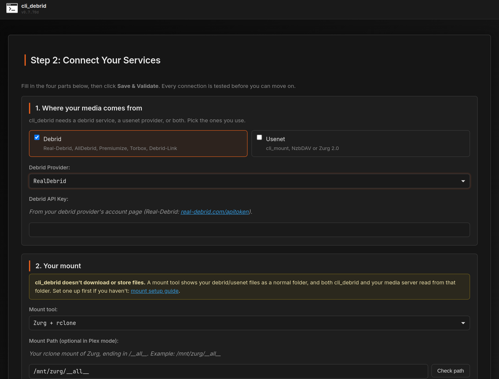

# Install with Docker

This guide covers installing cli_debrid using Docker and Docker Compose on Linux, macOS, or Windows. This is the recommended installation method.

!!! tip "Prefer a GUI?"
    If you use Portainer, Dockge, or Dockhand, the same Docker Compose file works — just paste it into your stack editor.

---

## Prerequisites

Before you begin, confirm you have:

- [Docker](https://docs.docker.com/get-docker/) installed and running
- [Docker Compose](https://docs.docker.com/compose/install/) v2 or later (`docker compose` command)
- A debrid account and/or a Usenet provider
- Plex, Jellyfin, or Emby
- A mount for your files. The [built-in mount](#easiest-one-container-with-the-built-in-mount) runs inside cli_debrid; the [cli_mount stack](#recommended-cli_debrid-and-cli_mount-in-one-stack) runs a separate mount container; [Zurg + rclone](../integrations/zurg.md) and [Decypharr](../integrations/decypharr.md) also work

!!! warning "Avoid Docker Desktop on Linux"
    On Linux servers, install Docker Engine directly — not Docker Desktop. Docker Desktop on Linux runs in a VM which can cause permission and mount issues with cli_debrid.

---

## Image tags

Every tag is multi-arch: the same tag works on amd64 and arm64 (Raspberry Pi, Apple Silicon).

| Tag | Branch | Notes |
|---|---|---|
| `godver3/cli_debrid:dev` | dev | **Recommended.** New features and fixes first |
| `godver3/cli_debrid:dev-<version>` | dev | A specific dev release, e.g. `dev-0.7.87` |
| `godver3/cli_debrid:latest` | dev | Same as `:dev` |
| `godver3/cli_debrid:main` | main | Updated less often, at the end of each development cycle |
| `godver3/cli_debrid:main-<version>` | main | A specific main release |

!!! note "Which tag should I use?"
    Use `:dev` for day-to-day use. Bugs are caught and fixed fastest on the dev branch. Use `:main` if you prefer less frequent updates.

---

## Easiest: one container with the built-in mount

cli_debrid's [built-in mount](../integrations/builtin-mount.md) streams your debrid account and your Usenet server from inside the cli_debrid container. This needs a Linux host running Docker Engine.

```bash
mkdir -p ${HOME}/cli_debrid && cd ${HOME}/cli_debrid
curl -o docker-compose.yml https://raw.githubusercontent.com/godver3/cli_debrid/dev/docker-compose.builtin.yml
docker compose up -d
```

Open `http://your-server-ip:5000` and follow the [onboarding wizard](../getting-started/configure.md). It picks the built-in mount, fills in `/mnt/clid/__all__`, and its last step checks that cli_debrid and your media server see the same folders. Give your media server `/mnt/clid` (with `:rslave`) and, for Symlink mode, `/mnt/symlinks`, at the same paths. The compose file has a Plex service you can uncomment. Every line is explained on the [built-in mount](../integrations/builtin-mount.md#docker-setup) page.

---

## cli_debrid and cli_mount in one stack { #recommended-cli_debrid-and-cli_mount-in-one-stack }

This setup runs cli_debrid and [cli_mount](../integrations/cli_mount.md) from one compose file. cli_mount mounts your debrid and Usenet files, and cli_debrid reads them from the same folder. This needs a Linux host running Docker Engine. Mount sharing between containers doesn't work in Docker Desktop on macOS or Windows.

Everything uses two folders on the host, and every container sees them at the **same path** as the host:

| Folder | What's in it |
|---|---|
| `/mnt/cli_mount` | The mount: your debrid and Usenet files. All files are in `/mnt/cli_mount/__all__` |
| `/mnt/symlinks` | Symlink mode only: the library cli_debrid builds with symlinks |

Keeping the paths identical everywhere (host, cli_mount, cli_debrid and your media server) is what makes file paths and symlinks work without any translation.

### 1. Create the shared folders

```bash
sudo mkdir -p /mnt/cli_mount /mnt/symlinks
sudo chown 1000:1000 /mnt/cli_mount
```

cli_mount runs as user `1000` (the `PUID` in the compose file) and can only mount into a folder that user owns. If you change `PUID`/`PGID`, use the same numbers here.

### 2. Create the compose file

```bash
mkdir -p ${HOME}/cli_debrid && cd ${HOME}/cli_debrid
curl -o docker-compose.yml https://raw.githubusercontent.com/godver3/cli_debrid/dev/docker-compose.cli_mount.yml
```

Or create `docker-compose.yml` with this content:

```yaml title="docker-compose.yml"
services:
  cli_mount:
    image: ghcr.io/mash2k3/cli_mount:dev
    pull_policy: always
    container_name: cli_mount
    restart: unless-stopped
    ports:
      - "8282:8282"
    volumes:
      - ./cli_mount:/app                          # (1)!
      - /mnt/cli_mount:/mnt/cli_mount:rshared     # (2)!
    devices:
      - /dev/fuse:/dev/fuse:rwm
    cap_add:
      - SYS_ADMIN
    security_opt:
      - apparmor:unconfined
    environment:
      - TZ=America/New_York                       # (3)!
      - PUID=1000                                 # (4)!
      - PGID=1000

  cli_debrid:
    image: godver3/cli_debrid:dev
    pull_policy: always
    container_name: cli_debrid
    restart: unless-stopped
    depends_on:
      cli_mount:
        condition: service_healthy                # (5)!
    ports:
      - "5000:5000"
    volumes:
      - ./cli_debrid/db_content:/user/db_content  # (6)!
      - ./cli_debrid/config:/user/config
      - ./cli_debrid/logs:/user/logs
      - ./cli_mount:/climount_data                # (7)!
      - /mnt/cli_mount:/mnt/cli_mount:rslave      # (8)!
      - /mnt/symlinks:/mnt/symlinks               # (9)!
    environment:
      - TZ=America/New_York
      - MALLOC_ARENA_MAX=2
    tty: true
    stdin_open: true
```

1. cli_mount's config, databases, logs and stream cache
2. The mount. `rshared` passes the mount cli_mount creates inside its container out to the host, where the other containers can see it
3. Your timezone — see the [full list](https://en.wikipedia.org/wiki/List_of_tz_database_time_zones)
4. The user cli_mount runs as. It must own `/mnt/cli_mount` on the host (step 1)
5. cli_debrid waits until cli_mount's web UI is answering
6. cli_debrid's databases — **back this up regularly**
7. cli_mount's data folder, shared with cli_debrid. cli_debrid backs up cli_mount's databases into it and reads its log
8. `rslave` lets cli_debrid see the mount, and see it again whenever cli_mount restarts, without restarting cli_debrid
9. Only needed in Symlink mode: where cli_debrid writes symlinks

### 3. Start the stack

```bash
docker compose up -d
docker compose ps
```

`cli_mount` should show `(healthy)` and `cli_debrid` should be `Up`.

### 4. Set up cli_mount

Open `http://your-server-ip:8282`. The setup wizard asks for:

| Step | Enter |
|---|---|
| Debrid / Usenet | Your debrid API key and/or your Usenet server. At least one is required |
| Download Folder | `/app/downloads` (cli_debrid doesn't use it) |
| Mount type | **DFS (cli_mount File System)** |
| Mount Path | `/mnt/cli_mount` |
| Cache Directory | `/app/cache` |

When the wizard finishes, check the mount from the host:

```bash
ls /mnt/cli_mount
```

You should see `__all__`, `nzbs`, `torrents` and `version.txt`. If the folder is empty, see [Troubleshooting](#troubleshooting-the-stack) below.

See the [cli_mount guide](../integrations/cli_mount.md#configuration) for its other settings.

### 5. Set up cli_debrid

Open `http://your-server-ip:5000` and follow the onboarding wizard (see [Step 5 — Complete onboarding](#step-5-complete-onboarding) for the full list). For the mount:

- **Mount tool:** cli_mount
- **Mount Path:** `/mnt/cli_mount/__all__`
- **Usenet:** choose cli_mount as the Usenet mount and click **Detect**. It finds `http://cli_mount:8282` (the compose service name)
- **Symlink mode:** set **Symlinked Files Path** to `/mnt/symlinks` (the default is `/mnt/symlinked`, which this stack doesn't map)

After onboarding, open **Settings → Required → Usenet Mount** and click **Detect** again. It also offers cli_mount's data path, `/climount_data`, for **cli_mount Data Path**. Setting it turns on backups of cli_mount's databases.

### 6. Connect your media server

Your media server needs the same folders at the same paths. If it runs in Docker, give it these volumes:

```yaml
    volumes:
      - /mnt/cli_mount:/mnt/cli_mount:rslave     # always
      - /mnt/symlinks:/mnt/symlinks              # Symlink mode
```

??? example "Plex in the same compose file"

    Add this under `services:`. Plex uses host networking, so in cli_debrid's onboarding its URL is `http://your-server-ip:32400`, not the service name.

    ```yaml
      plex:
        image: lscr.io/linuxserver/plex:latest
        container_name: plex
        network_mode: host
        restart: unless-stopped
        depends_on:
          cli_mount:
            condition: service_healthy
        volumes:
          - ./plex:/config
          - /mnt/cli_mount:/mnt/cli_mount:rslave
          - /mnt/symlinks:/mnt/symlinks
        environment:
          - TZ=America/New_York
          - PUID=1000
          - PGID=1000
          - VERSION=docker
    ```

    Add libraries pointing at `/mnt/symlinks/...` (Symlink mode) or `/mnt/cli_mount/__all__` (Plex mode).

If the media server runs directly on the host (not in Docker), point it at `/mnt/cli_mount` and `/mnt/symlinks` as they are.

### Troubleshooting the stack

**`/mnt/cli_mount` is empty, and cli_mount's log says `fusermount exited with code 256`.**
The mount folder isn't owned by cli_mount's user. Run `sudo chown 1000:1000 /mnt/cli_mount` (or your `PUID:PGID`), then `docker compose restart cli_mount`. cli_mount still shows as healthy in this state, so check the folder rather than the status.

**`docker compose up` fails with `path /mnt/cli_mount is mounted on / but it is not a shared mount`.**
The host's root isn't a shared mount (some minimal or older systems). Make the folder shared, then start again:

```bash
sudo mount --bind /mnt/cli_mount /mnt/cli_mount
sudo mount --make-rshared /mnt/cli_mount
```

To make that survive a reboot, add the same two commands to a startup script, or add `/mnt/cli_mount /mnt/cli_mount none bind,rshared 0 0` to `/etc/fstab`.

**cli_debrid or the media server sees an empty folder, but the host shows files.**
That container was given the folder without `:rslave`. Add it and recreate the container with `docker compose up -d`.

**Unraid:** use a pool path such as `/mnt/cache/cli_mount` instead of `/mnt/cli_mount`, everywhere it appears, so the mount doesn't wait for the array.

---

## cli_debrid on its own

Use this if you already have a mount, or use Zurg, Decypharr or NzbDAV.


## Step 1 — Create the directory

Create a directory to store cli_debrid's data:

```bash
mkdir -p ${HOME}/cli_debrid
cd ${HOME}/cli_debrid
```

---

## Step 2 — Create the Docker Compose file

Download the default compose file:

```bash
curl -O https://raw.githubusercontent.com/godver3/cli_debrid/dev/docker-compose.yml
```

Or create it manually:

```bash
nano docker-compose.yml
```

!!! tip "Stack all services in one compose file"
    You can combine cli_debrid, Zurg/Decypharr, Plex, and Jellyfin into a single `docker-compose.yml` by adding each as a separate service under the same `services:` block. This makes it easier to start, stop, and update everything together with one `docker compose up -d` command. The same applies in Portainer, Dockge, and Dockhand — just paste the merged file into your stack editor.

Choose the compose file that matches your file management mode:

=== "Symlink mode"

    Use this when running Jellyfin, Emby, or Plex with symlinks.

    ```yaml title="docker-compose.yml"
    services:
      cli_debrid:
        image: godver3/cli_debrid:dev
        pull_policy: always
        container_name: cli_debrid
        ports:
          - "5000:5000"
          - "5001:5001"
        volumes:
          - /path/to/appdata/db_content:/user/db_content    # (1) e.g. /mnt/cache/appdata/cli_debrid/db_content
          - /path/to/appdata/config:/user/config             # (2) e.g. /mnt/cache/appdata/cli_debrid/config
          - /path/to/appdata/logs:/user/logs                 # (3) e.g. /mnt/cache/appdata/cli_debrid/logs
          - /path/to/your/debrid/mount:/media/mount          # (4) e.g. /mnt/cache/zurg, /mnt/data/debrid — must match media server
          - /path/to/your/symlinks:/mnt/symlinked            # (5) e.g. /mnt/disk1/TVShows — must match media server
          - /path/to/plex/Library/Application Support/Plex Media Server:/plex_data  # (6) optional — overlay feature, Plex only
        environment:
          - TZ=America/New_York                              # (7) your timezone
          - MALLOC_ARENA_MAX=2                               # (8) optional — limits glibc memory arenas, reduces memory fragmentation in Python apps
        restart: unless-stopped
        tty: true
        stdin_open: true
    ```

    1. SQLite databases — **back this up regularly**
    2. Settings and configuration files
    3. Application log files
    4. Your debrid mount (Zurg or Decypharr) — container path must match your media server exactly
    5. Where cli_debrid writes symlinks — container path must match your media server exactly
    6. **Optional** — only needed for the Overlay feature. Path to your Plex Media Server data folder
    7. Set to your local timezone — see [full list](https://en.wikipedia.org/wiki/List_of_tz_database_time_zones)
    8. **Optional** — limits memory arena allocation, reduces memory usage. Recommended for all installs

    !!! warning "Container paths must match your media server"
        The debrid mount and symlink folder must use **identical container paths** in both cli_debrid and your media server (Plex/Jellyfin/Emby). If they differ, symlinks will appear broken. See [Plex](../integrations/plex.md) and [Jellyfin](../integrations/jellyfin.md) guides for matching examples.

    !!! warning "Unraid users"
        Use the actual pool path for your volumes (e.g. `/mnt/cache/appdata/cli_debrid`), not the user share path (`/mnt/user/...`). This avoids array startup issues.

=== "Plex mode"

    Use this when running Plex with Plex mode (no symlinks). Plex reads directly from the debrid mount.

    **cli_debrid**

    ```yaml title="docker-compose.yml (cli_debrid)"
    services:
      cli_debrid:
        image: godver3/cli_debrid:dev
        pull_policy: always
        container_name: cli_debrid
        ports:
          - "5000:5000"
          - "5001:5001"
        volumes:
          - /path/to/appdata/db_content:/user/db_content    # (1) e.g. /mnt/cache/appdata/cli_debrid/db_content
          - /path/to/appdata/config:/user/config             # (2) e.g. /mnt/cache/appdata/cli_debrid/config
          - /path/to/appdata/logs:/user/logs                 # (3) e.g. /mnt/cache/appdata/cli_debrid/logs
          - /path/to/your/debrid/mount:/media/mount          # (4) e.g. /mnt/cache/zurg, /mnt/data/debrid
          - /path/to/plex/Library/Application Support/Plex Media Server:/plex_data  # (5) optional — overlay feature
        environment:
          - TZ=America/New_York                              # (6) your timezone
          - MALLOC_ARENA_MAX=2                               # (7) optional — limits glibc memory arenas, reduces memory fragmentation in Python apps
        restart: unless-stopped
        tty: true
        stdin_open: true
    ```

    1. SQLite databases — **back this up regularly**
    2. Settings and configuration files
    3. Application log files
    4. Your debrid mount (Zurg or Decypharr)
    5. **Optional** — only needed for the Overlay feature. Path to your Plex Media Server data folder
    6. Set to your local timezone — see [full list](https://en.wikipedia.org/wiki/List_of_tz_database_time_zones)
    7. **Optional** — limits memory arena allocation, reduces memory usage. Recommended for all installs

    ```yaml title="docker-compose.yml (Plex)"
    services:
      plex:
        image: lscr.io/linuxserver/plex:latest
        container_name: plex
        network_mode: host
        volumes:
          - /path/to/your/debrid/mount:/debrid:ro            # (1) e.g. /mnt/cache/zurg, /mnt/data/debrid
          - /path/to/plex/appdata:/config:rw                 # e.g. /mnt/cache/appdata/plex
          - /path/to/plex/transcode:/transcode:rw            # e.g. /mnt/cache/appdata/plex/transcode
          - /path/to/plex/data:/data:rw                      # e.g. /mnt/cache/appdata/plex/data
        environment:
          - TZ=America/New_York
          - VERSION=latest
          - PUID=0
          - PGID=0
          - UMASK=022
        restart: unless-stopped
        devices:
          - /dev/dri:/dev/dri                                # (2) optional — hardware transcoding
    ```

    1. Your debrid mount — in Plex mode the container path does not need to match cli_debrid
    2. **Optional** — only needed for hardware transcoding

    !!! warning "Unraid users"
        Use the actual pool path for your volumes (e.g. `/mnt/cache/appdata/cli_debrid`), not the user share path (`/mnt/user/...`). This avoids array startup issues.

---

## Step 3 — Start the container

```bash
docker compose up -d
```

Check that the container started successfully:

```bash
docker compose logs -f
```

You should see output like:

```
cli_debrid  | Starting cli_debrid...
cli_debrid  | Web interface available at http://0.0.0.0:5000
```

Press `Ctrl+C` to stop following the logs.

---

## Step 4 — Access the web interface

Open your browser and navigate to:

```
http://your-server-ip:5000
```

The first time you visit, the onboarding wizard will launch automatically.


---

## Step 5 — Complete onboarding

The onboarding wizard will guide you through:

1. **Account setup**: create your admin account
2. **Connect your services**: your debrid and/or Usenet provider, your mount path, Plex or Symlink mode with your media server, and TVDB/TMDB keys. Each has a **Test** button
3. **Scrapers**: debrid users get Torrentio added automatically; Usenet users add their indexers
4. **Versions**: a 1080p Default version is added for you
5. **Content sources**: e.g. your Plex watchlist or Seerr requests
6. **Library management**: optionally scan or convert an existing library
7. **Review & start**: a summary, a health check of every connection, and **Start Program**

See [Step 4 — Configure](../getting-started/configure.md) for what each field means.



!!! tip "Take your time with onboarding"
    You can always change settings later via the Settings page. The onboarding just gets you to a working state quickly.

---

## Ports

| Port | Purpose |
|---|---|
| `5000` | Main web UI and API |
| `5001` | HTTPS / alternate access |

---

## Common commands

### View logs
```bash
docker compose logs -f cli_debrid
```

### Restart the container
```bash
docker compose restart cli_debrid
```

### Stop cli_debrid
```bash
docker compose down
```

### Update to the latest image
```bash
docker compose pull && docker compose up -d
```

See the full [Updating](updating.md) guide for more detail.

---

## Next steps

- [Complete the onboarding wizard](../configuration/index.md)
- [Configure scrapers](../configuration/index.md)
- [Add content sources](../configuration/index.md)
