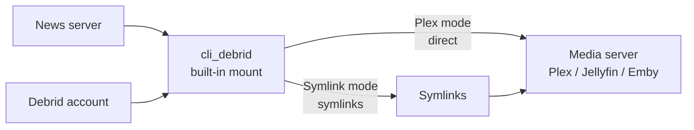

# Built-in mount

The built-in mount is cli_debrid's own mount engine. It runs inside the cli_debrid container, so there is no separate mount app to install. It streams your Usenet downloads (NZBs) straight from your news server, and the finished torrents in your debrid account: **Real-Debrid**, **AllDebrid**, **TorBox**, **Premiumize**, **Debrid-Link** or **HighWay**.

It's the default mount for new installs, for Usenet, debrid, or both. cli_mount, Decypharr, NzbDAV and Zurg are still available, and existing installs keep the mount they already use.



!!! note "Nothing is stored locally"
    Files are read from your news server or debrid service while you watch. A disk cache keeps recently read parts, so rewatching and seeking are faster.

**When to use it**

- **Any setup that can run it**: Usenet, debrid, or both. One container, and onboarding sets it up for you.
- **Use a separate mount instead** if Docker can't give cli_debrid FUSE access (some NAS systems), or you'd rather run the mount in its own container: [cli_mount](cli_mount.md), [Decypharr](decypharr.md) or [Zurg](zurg.md).

---

## Docker setup

The engine mounts its files inside the cli_debrid container with FUSE. The container needs FUSE access, and the mount folder has to be shared with the host so your media server can see it. The ready-made compose file has all of that:

```bash
mkdir -p ${HOME}/cli_debrid && cd ${HOME}/cli_debrid
curl -o docker-compose.yml https://raw.githubusercontent.com/godver3/cli_debrid/dev/docker-compose.builtin.yml
docker compose up -d
```

Or add these lines to your own compose file:

```yaml title="docker-compose.yml"
services:
  cli_debrid:
    image: godver3/cli_debrid:dev
    container_name: cli_debrid
    restart: unless-stopped
    ports:
      - "5000:5000"
      # - "8284:8284"                              # (1)!
    volumes:
      - ./cli_debrid/db_content:/user/db_content
      - ./cli_debrid/config:/user/config
      - ./cli_debrid/logs:/user/logs
      - ./cli_debrid/cache:/user/cache            # (2)!
      - /mnt/clid:/mnt/clid:rshared              # (3)!
      - /mnt/symlinks:/mnt/symlinks              # (4)!
    devices:
      - /dev/fuse:/dev/fuse:rwm
    cap_add:
      - SYS_ADMIN
    security_opt:
      - apparmor:unconfined
    environment:
      - TZ=America/New_York
    stop_grace_period: 40s                        # (5)!
```

1. Only for the [WebDAV share](#webdav-share).
2. The engine's disk cache (default 50 GB). Put it on a fast disk with room to spare.
3. The mount. `rshared` makes the files the engine mounts here show up on the host at `/mnt/clid`.
4. Your symlink folder, if you use Symlink mode.
5. Gives the engine time to unmount cleanly when the container stops, so no dead mount is left on the host.

**Your media server** gets the same host folder at the same path, with `rslave` so it sees the engine's mount. The compose file has a Plex service you can uncomment:

```yaml
    volumes:
      - /mnt/clid:/mnt/clid:rslave
      - /mnt/symlinks:/mnt/symlinks
```

!!! warning "Same path everywhere"
    cli_debrid and your media server must see the mount at the same path (`/mnt/clid` above). In Symlink mode the symlinks point at `/mnt/clid/__all__/...`, so a different path in Plex means broken links. Onboarding's last step checks this for you ([below](#path-checks)).

??? info "Windows (experimental)"
    On Windows the built-in mount uses [WinFsp](https://winfsp.dev) instead of FUSE. Install WinFsp first and set **Mount path** to a free drive letter such as `M:`. The Mount page lists what's missing if the engine can't start.

---

## Set it up

### During onboarding

In Step 2 of the onboarding wizard ([Configure](../getting-started/configure.md#debrid-or-usenet-provider)):

1. **Debrid:** tick **Debrid** and enter your API key. Nothing else to set: the mount lists the finished torrents in your account.
2. **Usenet:** tick **Usenet**, leave **Usenet Mount** on **Built-in mount** and enter your news server: **host**, **port** (usually `563` with **SSL**), **username**, **password** and **connections** (what your plan allows; leave a few free if you also download elsewhere).
3. **Mount tool** is **Built-in mount** on a new install and fills in **Mount Path** as `/mnt/clid/__all__`. If the container is missing FUSE access, the wizard says which compose lines are missing.
4. **Save & Validate** starts the engine. If your server login is wrong, the check says so (e.g. `can't connect to news.example.com: 502 Authentication Failed`).

For Usenet, add your indexers as [Newznab scrapers](../scrapers/newznab.md) in the next step, as with any Usenet mount.

#### Path checks

The wizard's last step tests your setup. For the mount it also checks:

| Check | Passes when |
|---|---|
| **Mount shared with host** | `/mnt/clid` is a host folder mapped with `:rshared` |
| **Symlink folder on host** | The symlink folder is a host folder, not inside the container |
| **Plex sees the mount** (or Jellyfin / Emby) | Your media server lists the same files at the same path |
| **Plex sees the symlinks** | A test folder cli_debrid creates in the symlink folder shows up in your media server at the same path (then it's removed) |

A failed check names the compose line to add or change.

### After onboarding

For Usenet, pick **Built-in mount** under **Settings → Required Settings → Usenet Mount → Provider**. For debrid only, turn on **Settings → Required Settings → Built-in Mount → Run the built-in mount for debrid**. A **Mount** item then appears in the top menu. Add your news server on its **Settings** tab (Usenet only), then click **Save**. Set **File Management → Original Files Path** to `/mnt/clid/__all__`.

---

## The Mount page

| Tab | What it's for |
|---|---|
| **Overview** | Engine and mount status, content, open streams, health, Plex protection, caches, and a table of each news server (connections in use, articles, missing, errors, latency). **Run cleanup** applies the cache limits now; **Purge cache** empties it |
| **Queue** | Every NZB and torrent the mount knows: status, size, errors. Search, filter, retry failed ones or delete |
| **Browse** | The mount's folders and files |
| **Settings** | News servers, virtual folders and all mount settings (below). **Save** applies them; **Restart engine** restarts it |
| **Migrate from cli_mount** | Move an existing cli_mount library over without re-downloading anything ([below](#moving-from-cli_mount)) |

The engine's own log is on the **Logs** page (**Mount** tab). While something plays from the mount, the home page shows **Now playing**: who is watching, the position, and whether it streams from Usenet or debrid.

!!! tip "The mount keeps running"
    The header has a **Start mount / Stop mount** button next to the program's Start/Stop. Stopping the program or restarting cli_debrid doesn't stop the mount, so playback isn't interrupted. Only **Stop mount**, saving a changed mount setting (a quick restart), or stopping the container does.

### News servers

Servers are tried top to bottom; use the arrows to reorder them. Tick **Backup** for fill or block accounts: they're only asked for an article the others don't have. Leave a password blank to keep the saved one.

### Mount layout

```
/mnt/clid/
  __all__/      ← everything (cli_debrid reads from here)
  Movies/       ← virtual folder: movies
  TV Shows/     ← virtual folder: shows
  nzbs/         ← Usenet downloads
  torrents/     ← debrid torrents
  realdebrid/   ← one folder per debrid service (alldebrid/, torbox/, premiumize/, debridlink/, highway/)
  __bad__/      ← downloads with a broken file
```

### Virtual folders

New installs start with **Movies** and **TV Shows**, using the filters from cli_mount's [Content routing](cli_mount.md#content-routing): every download lands in exactly one of the two. In **Plex mode**, point a Movies library at `/mnt/clid/Movies` and a TV library at `/mnt/clid/TV Shows`. In Symlink mode they're optional, handy for browsing.

Edit, rename or add folders on the **Settings** tab. On an older install, **Add Movies + TV Shows** adds the two default folders. A folder lists the downloads that match **all** its filters, except that a name regex and a files regex together match either one.

---

## Settings

All of these are on the Mount page's **Settings** tab. The defaults suit most setups.

| Group | Setting | Default | What it does |
|---|---|---|---|
| Mount | **Mount path** | `/mnt/clid` | Where the engine mounts inside the container |
| | **Let other users (Plex) read the mount** | On | Needed when Plex runs as another user |
| | **UID / GID / UMASK** | Container's PUID/PGID | Owner and permissions of the mounted files |
| Debrid | **Run the built-in mount for debrid (without usenet)** | Off | Runs the mount for a debrid-only setup. Onboarding turns it on when you pick **Built-in mount** as the mount tool |
| | **Stream debrid torrents through this mount** | On | Mirrors the finished torrents in your debrid account into the mount |
| WebDAV share | **Share the mount over WebDAV** | Off | A read-only copy of the mount over WebDAV ([below](#webdav-share)) |
| | **WebDAV port / username / password** | `8284` | The share stays off until a username and password are set |
| Files | **Allowed file extensions** | `mkv, mp4, m4v, avi, mov, mpg, mpeg` | Only these files are listed, so `.nfo`, images and archives stay out of your library. Empty lists everything |
| | **Deobfuscate mode** | Season/Episode | How new NZB imports name video files whose real name couldn't be found: `S01E01`-style, `Name - 01`, or off |
| Streaming | **Read ahead (MB)** | `16` | Fetched ahead of playback |
| | **Max connections per file** | `15` | Downloads at once for one playing file |
| | **Pre-cache on open (MB)** | `2` | Start and end of a file fetched the moment a player opens it, so playback starts sooner |
| | **Warm connections per server** | `2` | Kept logged in ahead of time (backups excluded) |
| | **Playback connection reserve %** | `10` | Share of each server's connections only playback may use |
| | **Plex playback protection** | On | The reserve only goes to files Plex reports playing, so library scans and thumbnails can't take it while someone watches. Needs your Plex URL and token |
| | **Buffer memory (MB)** | `512` | RAM for downloaded parts across all open files |
| | **Connection idle timeout** | 5 min | Unused connections are closed after this |
| Plex next-episode prewarm | **Prewarm the next episode while one plays** | On | Once an episode is 70% watched, the start of the next one (20%, at most 256 MB) is fetched so it starts instantly |
| Disk cache | **Cache directory / size** | `/user/cache/engine`, 50 GB | Use a folder of its own: the engine deletes files in it |
| | **Cache expiry / cleanup interval** | Off / 1 min | Drop cached parts unused for this many hours |
| Importing & health checks | **Processing connections / timeout** | `8` / 5 min | Used while reading a new NZB's archives. A timeout is retried, never treated as a dead release |
| | **NZB import availability sample %** | `1` | Share of articles checked before a download counts as added. Only a proven missing article rejects it |
| | **Repair availability sample %** | Automatic | Share of each file's articles checked by health checks (automatic = 10%, no cap, the same as cli_mount) |
| | **Check playability with ffprobe** | Off | Health checks also open each video file with ffprobe, like cli_mount's media probe |
| Advanced | **Debug logging** | Off | Logs every debrid link, API call and what each import found. Problems are always logged |

Repair follows cli_mount's rules, so a file is only marked broken on proof. Timeouts, connection errors and rate limits never count.

- **Usenet:** an article missing on every server, or short on every server (it decodes to less than its own yEnc trailer says), found during playback or a health check; a video file whose first bytes aren't its container's header; a download whose saved file map can't be read; and, with **Check playability with ffprobe** on, a video file ffprobe can't open or that has no audio or video stream. That option matches cli_mount's media probe, is off by default, and reads up to 5 MB per file per check. Replacements are always checked with ffprobe. **Migrate → Import** copies cli_mount's repair settings when it can see cli_mount's `config.json`.
- **Debrid:** health checks ask the service about each file, the same way cli_mount does: Real-Debrid's link check says 404 or a link fails with error 19, 24 or 35; TorBox no longer has the download; AllDebrid's link info reports an error; Premiumize has no link for the item; a Debrid-Link link answers 404/410; HighWay answers 404; or the torrent no longer has the file. The same answers during playback mark the file at once. cli_debrid's debrid repair then re-adds the torrent or finds another release.

---

## Debrid streaming

Every two minutes the mount lists the finished torrents in your debrid account, adds new ones to `__all__/` and to the service's own folder, and removes ones that are gone from the account. An empty listing never empties the mount.

Download links are created when a file is first read and kept until they expire, also across restarts (AllDebrid: 48 hours). That matters for **AllDebrid**, which suspends accounts that create many links without downloading. Real-Debrid packs a torrent into one archive link when it can't serve the files one by one; those torrents stay out of the mount.

---

## Subtitles

Subtitle files (`.srt`, `.ass`, `.ssa`, `.sub`, `.vtt`, `.idx`, `.sup`) can be saved into a download's folder in the mount, next to the video. cli_debrid's [subtitle downloader](../configuration/subtitles.md), Bazarr and your media server do this with ordinary file writes. They're stored in cli_debrid's data folder, listed next to the video, and deleted with the download. Everything else in the mount stays read-only.

---

## WebDAV share

For a media server on another machine (or Windows without WinFsp), the mount can also be shared over WebDAV, read-only:

1. On the Mount page's **Settings** tab, turn on **Share the mount over WebDAV** and set a **username** and **password**.
2. Publish the port in docker-compose: `- "8284:8284"`.
3. On the other machine, mount it with rclone (`rclone mount clid: /mnt/clid --vfs-cache-mode off`, with a `webdav` remote pointing at `http://your-server-ip:8284`, vendor `other`), and give the media server that folder at the same path as on cli_debrid's side (`/mnt/clid`).

Playback over WebDAV gets the same treatment as the mount: playback priority, **Now playing**, and repair of proven-missing files.

---

## Moving from cli_mount

The **Migrate from cli_mount** tab moves a cli_mount library into the built-in mount, keeping every download and its ID, so nothing is re-downloaded or re-added:

1. Set your news servers on the **Settings** tab.
2. **Start alongside**: the built-in mount starts on its own path (e.g. `/mnt/clid`) while cli_mount keeps serving.
3. **Import**: reads cli_mount's job list and saved file maps (no Usenet traffic). Safe to run again. Encrypted archives can't be imported.
4. **Compare 10 files**: reads random files through both mounts and compares them.
5. Stop the cli_mount container, then **Switch to the built-in mount**: it takes over cli_mount's mount path, so your symlinks and Plex keep working, and becomes the Usenet mount. cli_debrid needs `/dev/fuse`, `SYS_ADMIN` and cli_mount's mount folder bound with `rshared`.

cli_mount itself is never changed: **Switch back to cli_mount** undoes the switch.

---

## Troubleshooting

**The Mount page says the engine can't start.** It lists why: `/dev/fuse` missing (add the `devices` and `cap_add` lines), no news server set, or on Windows WinFsp missing.

**Plex shows an empty folder.** The media server's volume needs `rslave` (or `rshared`) on the same host folder, and cli_debrid's needs `rshared`. Restart the media server after changing it. Onboarding's **Mount shared with host** and **Plex sees the mount** checks catch this.

**A subtitle couldn't be saved.** Only subtitle files can be written into the mount, and only into a download's folder. The engine has to be running.

**A news server shows errors on the Overview tab.** Hover the error count for the last error. `authentication failed` means a wrong username or password; a timeout usually means a wrong port or SSL setting.

**A download failed with "nothing streamable".** The Queue tab shows why. A `missing article` is a dead release; cli_debrid's repair finds another one. Compressed or encrypted archives can't be streamed by any mount.
