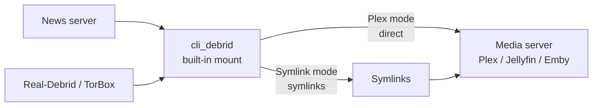

# Built-in mount

The built-in mount is cli_debrid's own mount engine. It runs inside the cli_debrid container, so there is no separate mount app to install. It streams your Usenet downloads (NZBs) straight from your news server, and it can also stream the finished torrents in your **Real-Debrid** or **TorBox** account.

It's the default Usenet mount for new installs. cli_mount, NzbDAV and Zurg 2.0 are still available, and existing installs keep the mount they already use.



!!! note "Nothing is stored locally"
    Files are read from your news server or debrid service while you watch. A disk cache keeps recently read parts, so rewatching and seeking are faster.

**When to use it**

- **Usenet**, with or without Real-Debrid / TorBox: use the built-in mount.
- **Other debrid services** (AllDebrid, Premiumize, Debrid-Link), or a debrid-only setup: use [cli_mount](cli_mount.md), [Decypharr](decypharr.md) or [Zurg](zurg.md). The built-in mount only runs when it's your Usenet mount.

---

## Docker setup

The engine mounts its files inside the cli_debrid container with FUSE. The container needs FUSE access, and the mount folder has to be shared with the host so your media server can see it.

```yaml title="docker-compose.yml"
services:
  cli_debrid:
    image: godver3/cli_debrid:dev
    container_name: cli_debrid
    ports:
      - "5000:5000"
    volumes:
      - /path/to/appdata/db_content:/user/db_content
      - /path/to/appdata/config:/user/config
      - /path/to/appdata/logs:/user/logs
      - /path/to/cache:/user/cache                     # (1)
      - /path/to/clid:/mnt/clid:rshared                # (2)
      - /path/to/symlinks:/mnt/symlinked               # (3) Symlink mode only
    devices:
      - /dev/fuse
    cap_add:
      - SYS_ADMIN
    security_opt:
      - apparmor:unconfined
    environment:
      - TZ=America/New_York
    stop_grace_period: 40s                             # (4)
    restart: unless-stopped
```

1. The engine's disk cache (default 50 GB). Put it on a fast disk with room to spare.
2. The mount. `rshared` makes the files the engine mounts here show up on the host at `/path/to/clid`.
3. Your symlink folder, if you use Symlink mode.
4. Gives the engine time to unmount cleanly when the container stops, so no dead mount is left on the host.

**Your media server** gets the same host folder at the same path, with `rslave` so it sees the engine's mount:

```yaml
    volumes:
      - /path/to/clid:/mnt/clid:rslave
```

!!! warning "Same path everywhere"
    cli_debrid and your media server must see the mount at the same path (`/mnt/clid` above). In Symlink mode the symlinks point at `/mnt/clid/__all__/...`, so a different path in Plex means broken links.

??? info "Windows (experimental)"
    On Windows the built-in mount uses [WinFsp](https://winfsp.dev) instead of FUSE. Install WinFsp first and set **Mount path** to a free drive letter such as `M:`. The Mount page lists what's missing if the engine can't start.

---

## Set it up

### During onboarding

In Step 2 of the onboarding wizard ([Configure](../getting-started/configure.md#debrid-or-usenet-provider)):

1. Tick **Usenet** and leave **Usenet Mount** on **Built-in mount**.
2. Enter your news server: **host**, **port** (usually `563` with **SSL**), **username**, **password** and **connections** (what your plan allows; leave a few free if you also download elsewhere).
3. **Mount tool** switches to **Built-in mount** and fills in **Mount Path** as `/mnt/clid/__all__`.
4. **Save & Validate** starts the engine. If your server login is wrong, the check says so (e.g. `can't connect to news.example.com: 502 Authentication Failed`).

Add your indexers as [Newznab scrapers](../scrapers/newznab.md) in the next step, as with any Usenet mount.

### After onboarding

Pick **Built-in mount** under **Settings → Required Settings → Usenet Mount → Provider**. A **Mount** item then appears in the top menu. Add your news server on its **Settings** tab, then click **Save**. Set **File Management → Original Files Path** to `/mnt/clid/__all__`.

---

## The Mount page

| Tab | What it's for |
|---|---|
| **Overview** | Engine and mount status, content, open streams, health, Plex protection, caches, and a table of each news server (connections in use, articles, missing, errors, latency). **Run cleanup** applies the cache limits now; **Purge cache** empties it |
| **Queue** | Every NZB and torrent the mount knows: status, size, errors. Search, filter, retry failed ones or delete |
| **Browse** | The mount's folders and files |
| **Settings** | News servers, virtual folders and all mount settings (below). **Save** applies them; **Restart engine** restarts it |
| **Migrate from cli_mount** | Move an existing cli_mount library over without re-downloading anything ([below](#moving-from-cli_mount)) |

The engine's own log is on the **Logs** page (**Mount** tab). While something plays from the mount, the home page shows **Now playing**: who is watching, the position, and whether it streams from Usenet or debrid.

!!! tip "The mount keeps running"
    The header has a **Start mount / Stop mount** button next to the program's Start/Stop. Stopping the program or restarting cli_debrid doesn't stop the mount, so playback isn't interrupted. Only **Stop mount**, saving a changed mount setting (a quick restart), or stopping the container does.

### News servers

Servers are tried top to bottom; use the arrows to reorder them. Tick **Backup** for fill or block accounts: they're only asked for an article the others don't have. Leave a password blank to keep the saved one.

### Mount layout

```
/mnt/clid/
  __all__/      ← everything (cli_debrid reads from here)
  Movies/       ← virtual folder: movies
  TV Shows/     ← virtual folder: shows
  nzbs/         ← Usenet downloads
  torrents/     ← debrid torrents
  realdebrid/   ← one folder per debrid account
  __bad__/      ← downloads with a broken file
```

### Virtual folders

New installs start with **Movies** and **TV Shows**, using the filters from cli_mount's [Content routing](cli_mount.md#content-routing): every download lands in exactly one of the two. In **Plex mode**, point a Movies library at `/mnt/clid/Movies` and a TV library at `/mnt/clid/TV Shows`. In Symlink mode they're optional, handy for browsing.

Edit, rename or add folders on the **Settings** tab. On an older install, **Add Movies + TV Shows** adds the two default folders. A folder lists the downloads that match **all** its filters, except that a name regex and a files regex together match either one.

---

## Settings

All of these are on the Mount page's **Settings** tab. The defaults suit most setups.

| Group | Setting | Default | What it does |
|---|---|---|---|
| Mount | **Mount path** | `/mnt/clid` | Where the engine mounts inside the container |
| | **Let other users (Plex) read the mount** | On | Needed when Plex runs as another user |
| | **UID / GID / UMASK** | Container's PUID/PGID | Owner and permissions of the mounted files |
| Debrid | **Stream debrid torrents through this mount** | On | Mirrors the finished torrents in your Real-Debrid / TorBox account into the mount |
| Files | **Allowed file extensions** | `mkv, mp4, m4v, avi, mov, mpg, mpeg` | Only these files are listed, so `.nfo`, images and archives stay out of your library. Empty lists everything |
| | **Deobfuscate mode** | Season/Episode | How new NZB imports name video files whose real name couldn't be found: `S01E01`-style, `Name - 01`, or off |
| Streaming | **Read ahead (MB)** | `16` | Fetched ahead of playback |
| | **Max connections per file** | `15` | Downloads at once for one playing file |
| | **Pre-cache on open (MB)** | `2` | Start and end of a file fetched the moment a player opens it, so playback starts sooner |
| | **Warm connections per server** | `2` | Kept logged in ahead of time (backups excluded) |
| | **Playback connection reserve %** | `10` | Share of each server's connections only playback may use |
| | **Plex playback protection** | On | The reserve only goes to files Plex reports playing, so library scans and thumbnails can't take it while someone watches. Needs your Plex URL and token |
| | **Buffer memory (MB)** | `512` | RAM for downloaded parts across all open files |
| | **Connection idle timeout** | 5 min | Unused connections are closed after this |
| Plex next-episode prewarm | **Prewarm the next episode while one plays** | On | Once an episode is 70% watched, the start of the next one (20%, at most 256 MB) is fetched so it starts instantly |
| Disk cache | **Cache directory / size** | `/user/cache/engine`, 50 GB | Use a folder of its own: the engine deletes files in it |
| | **Cache expiry / cleanup interval** | Off / 1 min | Drop cached parts unused for this many hours |
| Importing & health checks | **Processing connections / timeout** | `8` / 5 min | Used while reading a new NZB's archives. A timeout is retried, never treated as a dead release |
| | **NZB import availability sample %** | `1` | Share of articles checked before a download counts as added. Only a proven missing article rejects it |
| | **Repair availability sample %** | Automatic | Share checked by health checks (automatic = 2%, at most 30 per file) |
| Advanced | **Debug logging** | Off | Logs every debrid link, API call and what each import found. Problems are always logged |

A download is only marked broken when a missing article is proven. Timeouts and connection errors are retried.

---

## Moving from cli_mount

The **Migrate from cli_mount** tab moves a cli_mount library into the built-in mount, keeping every download and its ID, so nothing is re-downloaded or re-added:

1. Set your news servers on the **Settings** tab.
2. **Start alongside**: the built-in mount starts on its own path (e.g. `/mnt/clid`) while cli_mount keeps serving.
3. **Import**: reads cli_mount's job list and saved file maps (no Usenet traffic). Safe to run again. Encrypted archives can't be imported.
4. **Compare 10 files**: reads random files through both mounts and compares them.
5. Stop the cli_mount container, then **Switch to the built-in mount**: it takes over cli_mount's mount path, so your symlinks and Plex keep working, and becomes the Usenet mount. cli_debrid needs `/dev/fuse`, `SYS_ADMIN` and cli_mount's mount folder bound with `rshared`.

cli_mount itself is never changed: **Switch back to cli_mount** undoes the switch.

---

## Troubleshooting

**The Mount page says the engine can't start.** It lists why: `/dev/fuse` missing (add the `devices` and `cap_add` lines), no news server set, or on Windows WinFsp missing.

**Plex shows an empty folder.** The media server's volume needs `rslave` (or `rshared`) on the same host folder, and cli_debrid's needs `rshared`. Restart the media server after changing it.

**A news server shows errors on the Overview tab.** Hover the error count for the last error. `authentication failed` means a wrong username or password; a timeout usually means a wrong port or SSL setting.

**A download failed with "nothing streamable".** The Queue tab shows why. A `missing article` is a dead release; cli_debrid's repair finds another one. Compressed or encrypted archives can't be streamed by any mount.
